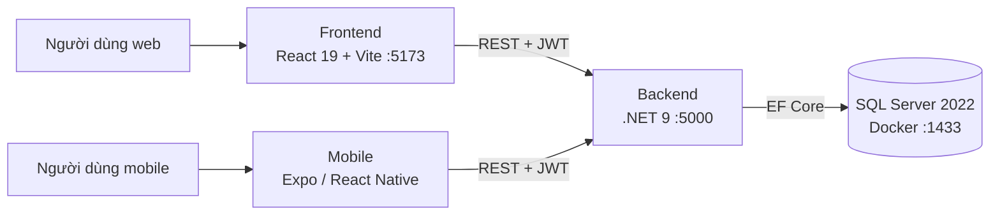

# CTXH — Hệ thống quản lý hoạt động công tác xã hội

Ứng dụng quản lý hoạt động CTXH cho sinh viên: đăng ký tham gia, điểm danh bằng QR,
xác nhận ngày công và thống kê theo từng sinh viên. Hệ thống gồm **backend API**,
**web frontend** và **ứng dụng mobile**.

> Cài đặt chi tiết cho từng hệ điều hành: xem [SETUP.md](SETUP.md).

---

## 1. Tính năng chính

| Vai trò | Chức năng |
|---|---|
| **Sinh viên** (`Student`) | Đăng ký/đăng nhập, xem danh sách hoạt động, đăng ký tham gia, quét QR điểm danh, xem lịch sử và tổng ngày công của mình |
| **Cán bộ Đoàn – Hội** (`Organizer`) | Tạo hoạt động, xem mã QR điểm danh, xem danh sách người tham gia, xác nhận (verify) ngày công |
| **Quản trị viên** (`Admin`) | Toàn bộ quyền của Organizer + quản lý người dùng |

Trạng thái tham gia: `Registered` → `CheckedIn` → `Verified` (hoặc `Rejected`).
Loại hoạt động: `CongTacXaHoi`, `LaoDong`.

## 2. Kiến trúc



- Backend chạy **native** (`dotnet run`), chỉ SQL Server chạy trong Docker.
- Backend tự chạy migration và seed dữ liệu mẫu khi khởi động (`Seed:Enabled`).
- Xác thực bằng JWT Bearer; phân quyền theo policy `Staff` (Organizer/Admin).

### Công nghệ

| Thành phần | Công nghệ |
|---|---|
| Backend | .NET 9, ASP.NET Core Minimal API, EF Core 9 (SQL Server), JWT Bearer, Scalar/OpenAPI |
| Frontend | React 19, Vite 8, React Router 7, Tailwind CSS v4, bộ UI kit `dthu-ui` |
| Mobile | Expo SDK 58, expo-router, React Native 0.88, expo-camera (quét QR), expo-secure-store |
| Cơ sở dữ liệu | SQL Server 2022 (container), EF Core Migrations |
| Tooling | `run.sh` (macOS/Linux/WSL), Docker Compose, AI-DLC (`aidlc/`) |

## 3. Cấu trúc thư mục

```
.
├── backend/                 # ASP.NET Core solution (Ctxh.slnx)
│   ├── src/
│   │   ├── Ctxh.Api/            # Minimal API, endpoints, middleware, cấu hình
│   │   ├── Ctxh.Application/    # Use case, DTO, abstraction
│   │   ├── Ctxh.Domain/         # Entity, enum, exception
│   │   └── Ctxh.Infrastructure/ # EF Core, migration, seeder, service
│   └── tests/               # Unit test (Domain, Application)
├── frontend/                # React + Vite (web)
│   └── src/
│       ├── features/        # auth, activities, participations
│       ├── pages/           # trang hệ thống, profile
│       ├── components/      # UI kit (ui/, blocks/) + component dùng chung
│       └── lib/             # api client, theme, hook
├── mobile/                  # Expo app (iOS/Android/web)
├── docker-compose.yml       # SQL Server 2022
├── run.sh                   # Chạy DB + backend + frontend (macOS/Linux/WSL)
├── SETUP.md                 # Hướng dẫn cài đặt theo hệ điều hành
└── aidlc/                   # Tài liệu & trạng thái quy trình AI-DLC
```

## 4. Cổng & dịch vụ

| Dịch vụ | URL / cổng | Ghi chú |
|---|---|---|
| Backend API | http://localhost:5000 | `Urls` trong `appsettings.json` |
| API docs (Scalar) | http://localhost:5000/scalar/v1 | Chỉ bật ở môi trường Development |
| OpenAPI JSON | http://localhost:5000/openapi/v1.json | Dùng để sinh type cho client |
| Frontend | http://localhost:5173 | CORS đã cấu hình sẵn |
| SQL Server | localhost:1433 | `sa` / `Ctxh@12345`, database `Ctxh` |
| Mobile (Expo) | http://localhost:8081 | Metro bundler |

## 5. Tài khoản seed

Seed chỉ chạy khi bảng `Users` đang rỗng.

| Mã đăng nhập | Mật khẩu | Vai trò |
|---|---|---|
| `admin` | `Admin@123` | Admin |
| `GV001` | `Org@12345` | Organizer |
| `SV001` | `Sv@12345` | Student |

Hoạt động mẫu: *“Mùa hè xanh – Dọn vệ sinh bờ sông”*, mã điểm danh `demo-ctxh-2026`.

## 6. API tóm tắt

Tất cả endpoint dưới `/api` đều cần `Authorization: Bearer <token>`, trừ `/api/auth/*`.
Đánh dấu 🔒 là yêu cầu quyền `Staff`.

| Method | Endpoint | Mô tả |
|---|---|---|
| POST | `/api/auth/register` | Đăng ký tài khoản sinh viên |
| POST | `/api/auth/login` | Đăng nhập, trả JWT |
| GET | `/api/activities` | Danh sách hoạt động |
| GET | `/api/activities/{id}` | Chi tiết hoạt động |
| POST | `/api/activities` 🔒 | Tạo hoạt động |
| GET | `/api/activities/{id}/qr` 🔒 | Lấy mã QR điểm danh |
| POST | `/api/activities/{id}/register` | Đăng ký tham gia |
| POST | `/api/activities/{id}/check-in` | Điểm danh bằng mã QR |
| GET | `/api/activities/{id}/participations` 🔒 | Danh sách người tham gia |
| POST | `/api/participations/{id}/verify` 🔒 | Xác nhận ngày công |
| GET | `/api/me` | Thông tin cá nhân |
| GET | `/api/me/summary` | Tổng hợp ngày công |
| GET | `/api/me/participations` | Lịch sử tham gia |

## 7. Bắt đầu nhanh

**macOS / Linux / WSL:**

```bash
./run.sh          # SQL Server (Docker) + backend + frontend
./run.sh stop     # dừng tất cả
```

**Windows (PowerShell/CMD):** chạy thủ công theo hướng dẫn trong [SETUP.md](SETUP.md#windows),
hoặc dùng WSL2 để chạy `./run.sh`.

Sau khi chạy: mở http://localhost:5173, đăng nhập bằng tài khoản seed ở mục 5.

## 8. Lệnh thường dùng

```bash
# Backend
dotnet build backend/Ctxh.slnx
dotnet test  backend/Ctxh.slnx
dotnet run --project backend/src/Ctxh.Api --launch-profile http

# Frontend
cd frontend && npm install && npm run dev
npm run build && npm run lint

# Mobile
cd mobile && npm install && npm start

# Database
docker compose up -d sqlserver      # bật DB
docker compose down                 # tắt (giữ dữ liệu)
docker compose down -v              # tắt + xoá dữ liệu (seed lại từ đầu)
```

## 9. Quy ước phát triển

- **Ngôn ngữ**: mã nguồn/API dùng tiếng Anh, nội dung hiển thị cho người dùng bằng tiếng Việt.
- **UI**: dùng component trong `frontend/src/components/ui` và `blocks` (kit `dthu-ui`), không hard-code mã màu — dùng token trong `src/styles`/`theme`.
- **Migration**: thêm migration bằng `dotnet ef` (xem SETUP.md), không sửa file migration đã commit.
- **Secrets**: `appsettings.json` chỉ chứa giá trị dev; production dùng biến môi trường (`ConnectionStrings__Default`, `Jwt__Key`).
- **Quy trình**: dự án dùng AI-DLC; xem `AGENTS.md` và thư mục `aidlc/` trước khi bắt đầu thay đổi lớn.

## 10. Tài liệu

- [SETUP.md](SETUP.md) — cài đặt môi trường cho Windows / Linux / macOS
- [AGENTS.md](AGENTS.md) — quy ước làm việc và AI-DLC
- `aidlc/` — trạng thái, quyết định và tài liệu của từng giai đoạn
